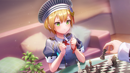

# HBR 壁纸图库

在浏览器里找《绯染天空》（Heaven Burns Red）的剧情 CG、角色卡面、场景背景和演出素材。支持放大看图、跨分类勾选、收藏和批量导出原始分辨率 PNG。

**运行环境**　Windows、Python 3.11 或更高版本、已安装的 Steam 版《绯染天空》。Release 提供图库程序，运行时读取你已安装的游戏资源。

**下载与导航**　[Windows ZIP][releases] · [三步开始](#三步开始) · [浏览收藏与保存](#浏览收藏与保存) · [游戏更新与缩略图](#游戏更新与缩略图) · [常见问题](#常见问题)

## 三步开始

1. **下载并解压。** 在 Release 的 `Assets` 里选择文件名以 `-Windows.zip` 结尾的附件，解压到有写入权限的文件夹。 [打开下载页面][releases]
2. **安装 Python 和依赖。** 安装 Python 时勾选 `Add Python to PATH`。进入解压后能看到 `requirements.txt` 的文件夹，在资源管理器地址栏输入 `cmd` 并回车，再依次执行下面的命令。 [下载 Python][python]

   ```bat
   python --version
   python -m venv .venv
   .venv\Scripts\python.exe -m pip install -r requirements.txt
   ```

3. **启动图库。** 双击 `运行壁纸图库.bat`，等待首次扫描完成，浏览器会自动打开。图库小窗口会显示当前访问地址。浏览器没有自动打开时，可把这个地址输到浏览器地址栏。点小窗口里的「退出图库」可关闭服务。

启动器优先使用项目下的 `.venv`。程序会自动查找 Steam 游戏目录。出现「未找到游戏资源目录」时，按[首次配置](#首次配置)填写路径即可。

## 图片预览

| 角色卡面 | 角色卡面 |
| --- | --- |
|  |  |
|  |  |

<details>
<summary>更多图片示例</summary>

| 角色卡面 | 角色卡面 |
| --- | --- |
|  |  |

</details>

## 浏览、收藏与保存

### 找图与查看大图

1. 在左侧展开「剧情 CG」的篇章和章节，或切换到角色卡面、场景背景等分类。搜索框可输入文件名、章节号或语言。用空格分隔多个关键词，结果会同时匹配这些词。
2. 可以按资源状态过滤，或选择「最近新增」「分辨率」等排序方式。勾选「1080p 以上」会筛出已识别尺寸且宽高至少为 `1920 × 1080` 的图片。
3. 点击缩略图打开查看器。原图可读时会继续加载原图。原图暂不可读时，可以查看已有的游戏预览。卡片上的「加载预览」按需下载所需的 Bundle，也可以勾选多张后用「批量加载预览」。

| 操作 | 查看器功能 |
| --- | --- |
| 滚轮或 `＋` / `−` | 缩放图片 |
| 鼠标拖动 | 平移图片 |
| 点击缩放百分比 | 回到初始缩放和位置 |
| `←` / `→` | 在当前筛选结果内切换图片 |
| `Esc` | 关闭查看器 |

### 收藏图片

点左侧「收藏夹」旁的 `＋` 新建收藏夹。勾选图片后，可切换到其他分类继续选。也可以点「全选筛选结果」选中当前结果。

在底部点「加入收藏夹」，选中一个或多个收藏夹，再点「加入」。查看某个收藏夹时，可以重命名或删除该收藏夹，也可以勾选图片后点「从收藏夹移除」。收藏记录按游戏资源路径保存，暂时离线的图片在资源恢复后会重新显示。

### 保存到本地

1. 打开右上角「设置」，点「浏览…」选择目录，或输入完整路径，再点「保存设置」。默认保存在图库文件夹下的 `HBR_Wallpapers/`，随时可以点「恢复默认」。
2. 保存单张图时，点卡片或大图查看器上的「保存原图」。要保存游戏内的预览图，使用「保存预览」。保存多张图时，勾选后点底部「批量保存」。
3. 若所选图片需要联网，确认框会显示待下载的 Bundle 数量和可估算的体积。确认后任务会下载资源并按分类保存 PNG。原图以原始分辨率保存，已保存的同一版本会跳过，同名的不同图片会追加文件名后缀。
4. 任务结束后，点「查看详情」查看成功、跳过和失败的结果。有失败项时可重试。点「打开保存目录」查看本次导出的文件。

## 游戏更新与缩略图

### 游戏更新后找新图

先在 Steam 完成游戏更新，有游戏内资源更新时也一并完成，然后点击图库顶部的「更新 Bundle 状态」。Bundle 是游戏存放贴图等素材的资源包。

这一步会扫描游戏安装目录、Unity 缓存和工具缓存，核对游戏提供的在线索引，下载图库缺少的 Bundle，再补齐本机可生成的缩略图。在线索引核对失败时，仍会更新本地资源状态。有之前保存的在线索引时会继续使用。

「Bundle 状态」面板显示各来源的数量和上次检查结果。如果工具下载的 Bundle 已经随游戏更新进入安装目录，图库会比较两个文件的全部内容。确认一致后，图库改用安装目录中的文件，并清理 `remote_q/` 下的工具副本。游戏安装目录和 Unity 缓存以只读方式访问。

### 补全缩略图和清理旧缓存

平时浏览时，图库会优先为当前可见图片加载缩略图，并把生成的图片保存在 `hbr_thumbs/256/`。重启后会直接复用有效缓存。

1. 点「缩略图状态」查看已缓存、待补全、暂不能补全和待清理的数量。
2. 点「一键补全缩略图」。程序先按整个图库索引清理失效缓存，再为本机可读且缺少缓存的图片生成缩略图。其他分类的有效缓存会保留，筛选和折叠目录也不会改变清理范围。
3. 面板会显示进度、清理张数和释放空间。「暂不能补全」表示当前缺少本机可读的资源。需要联网获取时，用「加载预览」按需下载，或用「更新 Bundle 状态」统一补齐。

## 首次配置

图库找不到游戏时，在 Steam 库中右键游戏，选择「管理」→「浏览本地文件」。从打开的游戏目录进入 `HeavenBurnsRed_Data/StreamingAssets/aa/StandaloneWindows64`，确认其上一级 `aa` 目录里有 `catalog.bin`。

在图库目录复制 `hbr_config.example.json`，把副本改名为 `hbr_config.json`，再将 `game_dir` 改为实际路径。下面的示例用正斜杠表示目录层级，可以直接照这个格式填写。

```json
{
  "game_dir": "D:/SteamLibrary/steamapps/common/HeavenBurnsRed/HeavenBurnsRed_Data/StreamingAssets/aa/StandaloneWindows64"
}
```

保存并重启图库。只在 Unity 缓存或 Addressables 在线目录缓存位于自定义位置时，分别设置可选的 `unity_cache_dir` 或 `cache_dir`。

## 更新与迁移

更新图库程序时，先退出图库，下载新版 ZIP，再将新版程序文件覆盖到原目录。如果新版更新了依赖，在相同目录重新执行安装命令。

```bat
.venv\Scripts\python.exe -m pip install -r requirements.txt
```

换电脑或移动到新目录时，复制需要保留的数据并在新目录重新创建 `.venv`。游戏安装路径或自定义导出路径变化时，分别修改 `hbr_config.json` 和图库「设置」。

| 文件或目录 | 保存的内容 |
| --- | --- |
| `hbr_config.json` | 手动设置的游戏路径和缓存路径 |
| `hbr_preferences.json` | 收藏夹、保存目录和最近的同步结果 |
| `hbr_selection.json`、`hbr_index.json`、`hbr_index_server.json` | 已勾选的图片和索引。迁移勾选时一起复制已生成的索引，以保留编号对应关系 |
| `hbr_thumbs/`、`hbr_info.json` | 缩略图和图片尺寸记录。复制后可继续复用 |
| `remote_q/` | 工具已下载的 Bundle 和在线目录缓存 |
| `HBR_Wallpapers/` | 默认导出目录。使用自定义目录时，从对应位置复制导出文件 |

## 常见问题

### 双击启动没反应，或提示缺少 Pillow / UnityPy

在图库文件夹打开 `cmd`，执行 `python --version` 检查版本，再按「三步开始」安装依赖。若已创建 `.venv`，可以用 `.venv\Scripts\python.exe hbr_gallery.pyw` 启动并查看命令行报错。

### 配置了路径，还是提示未找到游戏

确认配置文件名是 `hbr_config.json`，并检查 `game_dir` 指向的 `StandaloneWindows64` 上一级含有 `catalog.bin`。文件扩展名隐藏时，可在资源管理器开启显示后再检查。

### 收藏夹里找不到刚才选中的图片

勾选只是把图片加入待操作列表。要保存到收藏夹，还需要点击底栏的「加入收藏夹」并确认。若已经加入，可清空搜索并将资源状态切回「全部资源状态」。

### 保存时报错，或者找不到导出的文件

在「设置」确认目录有写入权限并点击「保存设置」。图片会存到该目录下的分类子目录。已执行过的任务可从「查看详情」打开本次保存目录和重试失败项。

### 游戏更新后没有看到新图

确认 Steam 和游戏内的资源更新已完成，再运行「更新 Bundle 状态」。如果有网络或下载错误，可在「Bundle 状态」或「查看详情」里查看结果。

## 项目结构

| 路径 | 用途 |
| --- | --- |
| `hbr_gallery.pyw` | 游戏索引解析、贴图解码、后台任务及本地 HTTP 服务 |
| `web/` | 静态 HTML、CSS 和 JavaScript，无需前端构建 |
| `运行壁纸图库.bat` | Windows 启动器 |
| `requirements.txt`、`hbr_config.example.json` | Python 依赖和路径配置模板 |

HTTP 服务只监听本机回环地址。游戏美术和预览素材归各自权利方所有。

[releases]: https://github.com/ruka810/HBR-Wallpaper-Gallery/releases
[python]: https://www.python.org/downloads/windows/
